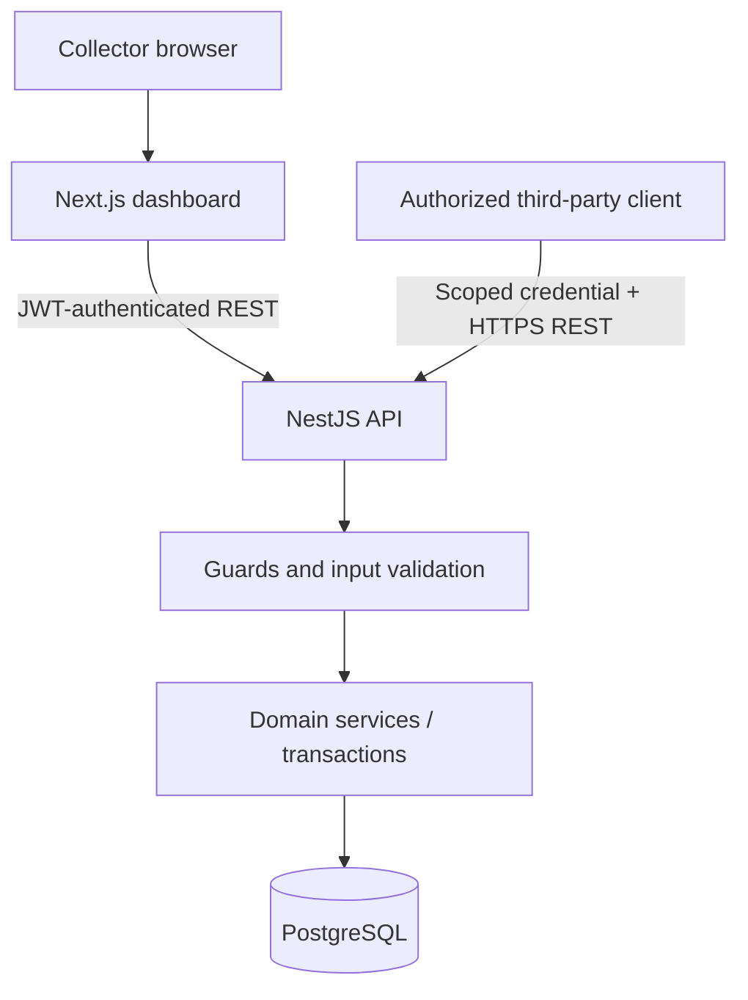

# Architecture · AjoDesk

## 1. Boundary
AjoDesk is a self-contained third-party system. Its API is usable by a web dashboard, command-line client, or external agent without depending on any particular AI or messaging vendor. **There is no Chord module, tool implementation, or agent skill in this repository.**



## 2. Components
- `apps/web`: collector admin UI, authenticated sessions, contributor/plan/enrollment pages, history, schedule summaries, contribution confirmation.
- `apps/api`: NestJS modules: `Auth`, `Collectors`, `Contributors`, `Plans`, `Enrollments`, `Contributions`, `ContributionIntents`, `IntegrationCredentials`, `Audit`, `Health`.
- PostgreSQL: collector-scoped transactional data, unique constraints, idempotency state, and immutable event history.
- `docs/*`: contracts and acceptance criteria. No business rules should be hidden exclusively in prompts or frontend code.

### Dashboard (as built)
`apps/web` is a backend-for-frontend. Server Components read through `src/lib/api.ts` (server-only, `cache: "no-store"`), and Server Actions perform the writes. The collector JWT lives in the HttpOnly `ajodesk_session` cookie. `src/proxy.ts` (Next 16's renamed middleware) only does optimistic sign-in redirects; the API authorizes every call. The UI shows API figures as-is. Its only arithmetic is the pre-confirmation total (daily amount × selected days), which the API recomputes and rejects on mismatch. The schedule grid's paid/missed/upcoming states come from the summary's `paidDates` and `unpaidDates`.

## 3. Authentication boundary
All API requests resolve a trusted principal server-side:

```text
Principal = { collectorId, actorType: 'COLLECTOR' | 'INTEGRATION',
              actorId, scopes: string[] }
```

- Browser: collector login with short-lived access token or secure server-managed session. Never place integration secrets in browser JavaScript.
- Integration: random credential sent over HTTPS in `Authorization: Bearer <key>`; only a hash is stored. The credential's DB record maps to exactly one collector and carries scopes.
- Use guards/policies to authorize each route; never authorize based on `collectorId`, phone, or name in JSON.
- External clients may search/read with a read scope; writing requires explicit write scopes.

## 4. Core contribution flow
### Direct collector dashboard flow
`POST /contributions` → validate principal/enrollment/dates → acquire enrollment lock → check idempotency → create contribution and allocations + audit in one transaction → return stored record. The dashboard should still show a confirmation step before invoking the endpoint.

### Generic two-step integration flow
1. `POST /contribution-intents` creates an expiring `PENDING` intent. It **does not** change balances.
2. Client shows the returned immutable summary to the operator.
3. `POST /contribution-intents/{id}/confirm` verifies the same principal, checks expiry and state, and calls the same transaction-safe contribution service.
4. Response includes contribution ID and an authoritative financial summary. Duplicate confirms return the already committed result.

A confirmation endpoint proves consistency and single execution, **not** the real-world identity of whoever typed a confirmation into a messaging service. Stronger user authentication is a go-live requirement for real customer money records.

## 5. Data and failure semantics
- **Authority:** only posted database records count toward summaries; pending intents do not.
- **Retries:** clients use stable `Idempotency-Key` headers. A same-key/same-payload retry returns the stored outcome; same key/different payload returns `409`.
- **Concurrency:** lock the enrollment (or an equivalent serializable resource) before selecting/unpaid-date validation and insert; database uniqueness on allocations is the final backstop.
- **Transactions:** contribution row, allocations, idempotency result and audit event commit atomically.
- **Unknown outcome:** when a client times out, query by intent or retry the same idempotency key; don't generate a new key for an uncertain write.
- **Errors:** stable machine-readable `code`, readable `message`, and `requestId`; do not leak SQL/stack traces.

## 6. Deployment
- Local: Docker Compose with API, Next.js, PostgreSQL and health checks.
- Remote: deploy API behind TLS and connect it to a private PostgreSQL instance. Migrations run explicitly; don't expose DB port to the public internet.
- Configure allowed web origins and secret management; use distinct demo vs real-world environments.
- Logging: correlation/request IDs, no plaintext API keys, access tokens, passwords or unnecessary personal data.

## 7. Deliberate trade-offs
- Single NestJS app rather than microservices.
- PostgreSQL constraints + transactions instead of message queues for MVP correctness.
- One fixed-value allocation per daily schedule date in MVP; partial payments deferred.
- External integration is a generic scoped REST client, not a special `/agent` API.
- No Paystack integration in initial scope; test cash records suffice for an external API write demonstration.
