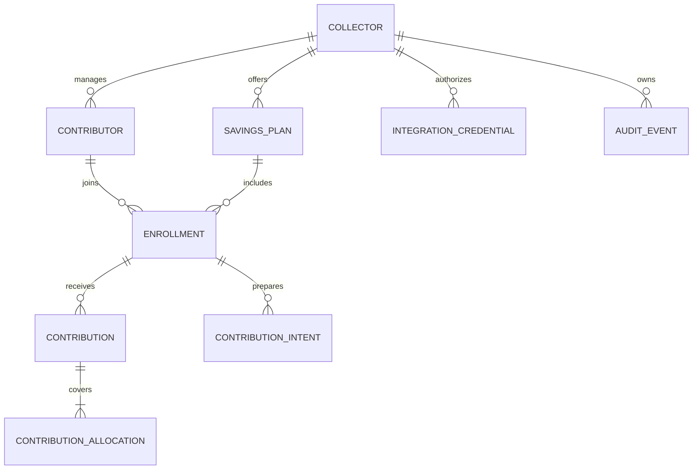

# Database and financial rules · AjoDesk

## 1. Conventions
- PostgreSQL; UUID primary keys; `created_at` / `updated_at` as `timestamptz` where appropriate.
- Currency fixed to `NGN` in MVP; integer minor units (`amount_minor` in **kobo**), never `float`/JS currency arithmetic.
- Scheduled dates are PostgreSQL `date` values in the business calendar `Africa/Lagos`; events are UTC timestamps.
- All collector-owned entities have ownership checks. Use foreign keys and a collector scope in query predicates, not guessed identifiers.
- Real customer data must not be seeded or included in test fixtures.

## 2. Relational model

### `collectors`
`id`, `full_name`, `email` (unique, case normalized), `phone` (optional), `password_hash`, `status`, timestamps.

### `contributors`
`id`, `collector_id` FK, `full_name`, `phone` nullable, `status`, timestamps. Index `(collector_id, full_name)`. Names are not unique.

### `savings_plans`
`id`, `collector_id` FK, `name`, `daily_amount_minor` positive integer, `currency = 'NGN'`, `frequency = 'DAILY'`, `start_on` date, `end_on` date, `status` (`ACTIVE`, `CLOSED`), timestamps. Constraint `end_on >= start_on`.

### `enrollments`
`id`, `collector_id` FK, `plan_id` FK, `contributor_id` FK, `start_on`, `end_on`, `status` (`ACTIVE`, `CLOSED`), timestamps. `unique(plan_id, contributor_id)` for MVP. Check enrollment date interval within plan interval. Service verifies collector owns both relationships.

### `contributions`
`id`, `collector_id` FK, `enrollment_id` FK, `amount_minor` positive integer, `currency = 'NGN'`, `payment_method = 'CASH'`, `verification_status = 'COLLECTOR_ATTESTED'`, `collected_on` date, `idempotency_key`, `request_hash`, `recorded_by_type`, `recorded_by_id`, `status = 'POSTED'`, `created_at`. Unique scoped idempotency key (see below). This is a **record**, not evidence of a bank transaction.

### `contribution_allocations`
`id`, `contribution_id` FK, `enrollment_id` FK, `scheduled_on` date, `amount_minor` positive integer. Unique `(enrollment_id, scheduled_on)` in MVP because each scheduled day is paid at most once. Check selected days are within enrollment. Create all allocations in the same transaction as their contribution.

### `contribution_intents`
`id`, `collector_id` FK, `enrollment_id` FK, `created_by_type`, `created_by_id`, `dates_json` (validated sorted unique ISO dates), `amount_minor`, `currency`, `status` (`PENDING`, `COMPLETED`, `EXPIRED`, `CANCELLED`), `expires_at`, `completed_contribution_id` nullable FK, `created_at`. `amount_minor` and dates are immutable after creation. Keep intents separate from financial postings.

### `integration_credentials`
`id`, `collector_id` FK, `label`, `key_prefix`, `secret_hash`, `scopes` (validated list), `status`, `expires_at` nullable, `last_used_at`, `created_at`, `revoked_at`. Return the secret only when created; never expose a stored plaintext key.

### `idempotency_records`
`id`, `collector_id`, `actor_id`, `operation`, `idempotency_key`, `request_hash`, `result_resource_id`, `created_at`; unique `(collector_id, actor_id, operation, idempotency_key)`. Keep sufficient metadata to resolve retries. Do not return cached success without ensuring the linked committed record exists.

### `audit_events`
`id`, `collector_id`, `actor_type`, `actor_id`, `action`, `entity_type`, `entity_id`, `metadata_json`, `created_at`. Append only. Redact private fields and secrets.

## 3. Posting invariants
1. The authenticated principal's collector owns the enrollment, contributor and plan.
2. Enrollment and plan are active and the requested scheduled dates are within their eligible interval.
3. `scheduledDates` contains sorted/unique values; enforce uniqueness server-side even if client does not sort.
4. Every date is fully unpaid. Partial payments are **out of scope** initially.
5. `amountMinor == plan.dailyAmountMinor × scheduledDates.length`; server recomputes and rejects a mismatch.
6. `sum(contribution_allocations.amount_minor) == contribution.amount_minor`.
7. One active allocation per `(enrollment_id, scheduled_on)`. Enforce via DB unique constraint and concurrent write locking.
8. Contributions and audit events cannot be silently deleted or updated. Corrections require a later reversal feature with a full audit trail.
9. A contribution intent can move to `COMPLETED` once, with one linked contribution. Confirming an already-completed intent returns the same record.
10. No negative balances or payouts exist in this MVP because no cash disbursement is modeled.

## 4. Schedule and summary calculations
Let `today` be an explicit `asOf` ISO date (default current date in Africa/Lagos). For one enrollment:

- `eligibleDays`: all daily dates from enrollment start to enrollment end, inclusive.
- `dueDays`: eligible dates on or before `asOf`.
- `recordedTotalMinor`: sum of **posted** contribution amounts across all eligible dates, including future prepayments.
- `dueMinor`: `count(dueDays) × dailyAmountMinor`.
- `paidTowardDueMinor`: sum of allocations whose scheduled date is in `dueDays`.
- `outstandingDueMinor`: `max(0, dueMinor - paidTowardDueMinor)`.
- `prepaidMinor`: sum of allocations with a scheduled date after `asOf`.
- `unpaidDates`: `dueDays` with no allocation; `upcomingDates` are not overdue.

**Example:** 3 days due at ₦1,000/day, 2 paid and 1 future date prepaid. Recorded total ₦3,000, due-to-date ₦3,000, paid toward due ₦2,000, outstanding due ₦1,000, prepaid ₦1,000. These values must not be conflated.

## 5. Transactions and retries
- Generate a stable request hash from canonical normalized fields (dates, amount, enrollment, payment method), not from a JSON property order.
- Serialize writes at enrollment level, then validate currently unpaid dates before inserting.
- Use a unique idempotency key for each intended **new** write; a repeated request with the same key and payload returns the prior result.
- On same key with different payload, return `409 IDEMPOTENCY_CONFLICT`.
- For uncertain write outcomes, client must query the contribution intent or retry with the original key.

## 6. As-built notes
- `contribution_intents` also stores `payment_method`, `completed_at` and `updated_at`. A CHECK constraint ties `status = 'COMPLETED'` to a non-null, unique `completed_contribution_id`.
- A `BEFORE UPDATE OR DELETE` trigger (`ajodesk_reject_mutation`) makes `contributions`, `contribution_allocations` and `audit_events` append-only at the database level.
- `contributions` has a unique `(collector_id, recorded_by_id, idempotency_key)`. Confirmed intents post with the internal key `intent:<intentId>` (client keys cannot contain `:`).
- Money columns are `bigint` and are mapped to JS safe integers. `date` columns are kept as `YYYY-MM-DD` strings (pg type parser override), never JS `Date`.
- `collected_on` is the Lagos calendar date on which the record was posted.

## 7. Migrations and future features
Use TypeORM migrations, not `synchronize: true`. Add indexes for collector ownership and common date queries. Do not implement partial payments, reversals, paid-out balances, commission deductions, or provider-verified transfers until their ledger semantics and tests are separately specified.
